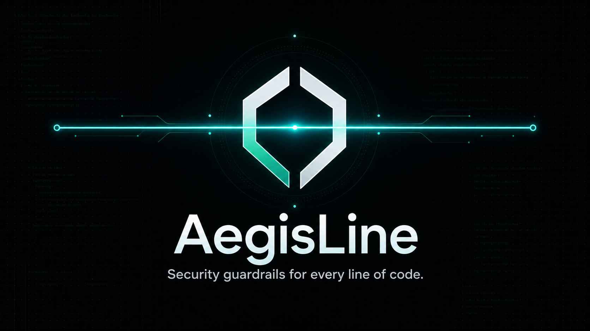
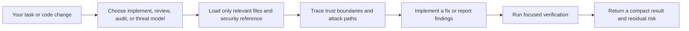

# AegisLine



**Security guardrails for every line of code.**

AegisLine is a token-efficient security agent for Claude Code, Codex, GitHub Copilot CLI, Cursor, and OpenCode. It helps build, review, audit, threat-model, and fix frontend, backend, API, mobile, infrastructure, systems, and AI applications in any programming language.

It reasons from real trust boundaries and attack paths, selects language-native controls, and verifies the result. Detailed guidance loads only for the surface being changed.

> AegisLine is an engineering guardrail, not a security guarantee or a replacement for scanners, penetration testing, mobile testing, AI red teaming, or human review.

## What it can do

| Capability | Behavior |
|---|---|
| Secure implementation | Builds or changes code with relevant security controls and focused tests |
| Fix confirmed issues | Applies the smallest robust fix when explicitly requested |
| Diff review | Finds evidence-backed attack paths in current changes without modifying files |
| Repository audit | Maps entry points and trust boundaries, then checks high-risk flows first |
| Threat modeling | Identifies assets, actors, abuse cases, controls, validation, and residual risk |
| Standards mapping | Maps observed evidence to current OWASP guidance without claiming compliance |



## Commands

| Task | Codex | Claude Code | Copilot CLI | Cursor / OpenCode |
|---|---|---|---|---|
| Secure or fix | `$aegisline` | `/aegisline:aegisline` | `/aegisline` | `/aegisline` |
| Review current diff | `$aegisline-review` | `/aegisline:aegisline-review` | `/aegisline-review` | `/aegisline-review` |
| Audit repository | `$aegisline-audit` | `/aegisline:aegisline-audit` | `/aegisline-audit` | `/aegisline-audit` |
| Show help | `$aegisline-help` | `/aegisline:aegisline-help` | `/aegisline-help` | `/aegisline-help` |

Claude Code namespaces installed plugin skills as `plugin-name:skill-name`. Copilot CLI, Cursor, and OpenCode use the direct skill or command name.

## Easy installation

Public repository: [akhilthakurdev/AegisLine](https://github.com/akhilthakurdev/AegisLine)

### Requirements

- The coding assistant you want to use.
- Git for installing or copying adapters from GitHub.
- Node.js 18 or newer for the bundled lifecycle hook when the host supports and enables it. The skills themselves have no runtime dependencies.

### Codex — install once

**Step 1 — run these commands in PowerShell or another terminal:**

```powershell
codex plugin marketplace add akhilthakurdev/AegisLine
codex plugin marketplace list
codex
```

**Step 2 — inside Codex:**

1. Enter `/plugins`.
2. Open the **AegisLine** marketplace.
3. Select **AegisLine**, then select **Install**.
4. Enter `/hooks`, inspect the AegisLine hook, and trust it only if it matches this repository.
5. Enter `/new` to start a fresh task.
6. Enter `$aegisline-help` to confirm the installation.

After installation, use `$aegisline` to secure or fix code, `$aegisline-review` to review changes, and `$aegisline-audit` to audit the repository.

### Claude Code — install once

**Step 1 — start Claude Code from your project terminal:**

```powershell
claude
```

**Step 2 — enter these commands separately inside Claude Code:**

```text
/plugin marketplace add akhilthakurdev/AegisLine
/plugin install aegisline@aegisline
/reload-plugins
```

**Step 3 — confirm the installation:**

```text
/aegisline:aegisline-help
```

After installation, use `/aegisline:aegisline` to secure or fix code, `/aegisline:aegisline-review` to review changes, and `/aegisline:aegisline-audit` to audit the repository.

### Where the plugin is saved

- Codex keeps installed copies under `~/.codex/plugins/cache/`.
- Claude Code keeps installed copies under `~/.claude/plugins/cache/`.
- Do not edit cached copies. Update the GitHub repository and refresh or reinstall the plugin instead.

### GitHub Copilot CLI

Run in a terminal:

```powershell
copilot plugin marketplace add akhilthakurdev/AegisLine
copilot plugin install aegisline@aegisline
copilot
```

Then test:

```text
/aegisline-help
/aegisline-review
```

### Cursor

1. Clone or download AegisLine.
2. Copy `.cursor/rules/aegisline.mdc` into your project's `.cursor/rules/` directory.
3. Copy the four files from `.cursor/commands/` into your project's `.cursor/commands/` directory.
4. Reload the project and select an `aegisline-*` command from `/` in Agent chat.

Merge the AegisLine files; do not replace an existing `.cursor` directory. See the [Cursor rules](https://docs.cursor.com/context/rules) and [commands](https://docs.cursor.com/en/agent/chat/commands) documentation.

### OpenCode

1. Clone or download AegisLine.
2. Copy `.opencode/commands/*.md` into your project's `.opencode/commands/` directory.
3. Copy AegisLine's `AGENTS.md` if the project has none; otherwise merge its short guidance.
4. Start OpenCode in the project and run `/aegisline-help`.

Global commands can go in `~/.config/opencode/commands/`; global guidance can be merged into `~/.config/opencode/AGENTS.md`. See the [OpenCode commands](https://opencode.ai/docs/commands/) and [rules](https://opencode.ai/docs/rules/) documentation.

## Use it

### Build securely

```text
$aegisline Implement this file-upload endpoint securely and test the changed boundaries.
```

### Fix confirmed findings

```text
$aegisline Fix the confirmed authorization findings, preserve current behavior, and run focused tests.
```

The main command may modify code within the requested scope. Review and audit commands remain read-only.

### Review current changes

```text
$aegisline-review
```

Use the host-specific syntax from the command table. A review defaults to the current diff.

### Audit a repository

```text
$aegisline-audit
```

An audit maps the repository and checks high-risk trust boundaries first. It uses more time and tokens than a diff review.

### Threat-model a feature

```text
$aegisline threat-model the payment and refund flow
```

## Result format

AegisLine keeps reports compact and actionable:

```text
## Security review

### [High] Missing tenant authorization
- Location: src/orders.ts:84
- Confidence: High
- Attack path: authenticated user -> caller-controlled order ID -> unrestricted lookup
- Preconditions: any account
- Impact: cross-tenant order disclosure
- Fix: scope the lookup to the authenticated tenant and deny missing ownership
- Verify: request another tenant's order ID and expect a generic denial

## Coverage
- Reviewed: order read flow and authorization middleware
- Not reviewed: deployment configuration
- Verification: focused tests passed; dynamic testing not run
```

Findings require a plausible attack path. Missing best practices and speculative hardening are not reported as vulnerabilities.

## Security coverage

| Surface | Representative checks |
|---|---|
| Frontend | XSS and DOM sinks, CSRF, OAuth/OIDC clients, browser storage, CSP, messages, redirects, prototype pollution |
| Backend and APIs | identity, object/field/tenant authorization, injection, SSRF, uploads, webhooks, sessions, races, resource abuse |
| Mobile | secure storage, IPC and deep links, WebViews, biometrics, TLS, privacy, permissions, signing and updates |
| AI, LLM, RAG, MCP, agents | prompt and goal injection, tool authorization, confused deputy, memory/RAG poisoning, output validation, leakage, cost bounds |
| Infrastructure and supply chain | CI identity, secrets, dependency provenance, build scripts, SBOMs, cloud permissions, containers, egress |
| Systems and embedded | memory and parser safety, FFI, IPC, privilege boundaries, signed updates, secure boot, recovery |

The core reasoning works for every programming language. AegisLine detects the actual runtime and framework, then chooses maintained, language-native primitives. Its routing includes web and mobile languages, JVM and .NET ecosystems, Go, Rust, C/C++/Zig, Erlang/Elixir, data/query languages, shell, smart contracts, WebAssembly, and infrastructure configuration.

## Standards alignment

AegisLine uses current primary guidance as coverage aids:

- OWASP Top 10:2025 and ASVS 5.0.0;
- OWASP API Security Top 10:2023;
- OWASP MASVS, MASWE, and MASTG;
- OWASP Top 10 for LLM Applications 2025;
- OWASP Top 10 for Agentic Applications 2026;
- NIST SSDF 1.1 and NIST AI RMF Generative AI Profile;
- CISA Secure by Design.

Source review alone cannot establish compliance with any standard.

## Token-efficient design

1. The lifecycle hook injects one compact baseline only at session start, resume, clear, or compaction.
2. It does not repeat the baseline for every prompt.
3. Implementation, review, audit, and help are separate small skills.
4. Frontend, backend, mobile, AI, platform, language, standards, and verification references load only when relevant.
5. Review reads the current diff by default; audit is reserved for broad repository coverage.

## Repository-only fallback

If a host cannot install plugins, copy or merge the relevant file:

- Codex, OpenCode, and AGENTS.md-compatible agents: `AGENTS.md`
- Claude Code: `CLAUDE.md`
- GitHub Copilot: `.github/copilot-instructions.md`
- Cursor: `.cursor/rules/aegisline.mdc`

This provides the compact baseline. Copy the host command adapters when you also want the named review, audit, and help commands.

## Test locally

```powershell
npm test
```

Claude Code:

```powershell
claude --plugin-dir .
```

Codex:

```powershell
codex plugin marketplace add .
codex
```

Then install from `/plugins`, review the hook, and start a new task. Cursor and OpenCode discover their project files automatically when opened from this repository.

## Project structure

```text
.agents/plugins/marketplace.json Codex marketplace
.codex-plugin/plugin.json       Codex manifest
.claude-plugin/                 Claude/Copilot marketplace and manifest
.cursor/                        Cursor rule and commands
.opencode/                      OpenCode commands
hooks/ and scripts/             Compact session activation
skills/aegisline/               Secure implementation and focused references
skills/aegisline-review/        Diff-focused read-only review
skills/aegisline-audit/         Risk-prioritized repository audit
skills/aegisline-help/          One-shot command reference
test/                           Packaging, token-budget, and adapter tests
```

## Safety and privacy

AegisLine has no runtime dependencies and sends no code anywhere. Its activation hook reads the host event from standard input and returns static guidance. It does not read project files, credentials, or network data.

Report vulnerabilities privately according to [SECURITY.md](SECURITY.md).

## Contributing and license

See [CONTRIBUTING.md](CONTRIBUTING.md). Run `npm test` before submitting changes.

Licensed under Apache-2.0. See [LICENSE](LICENSE).
